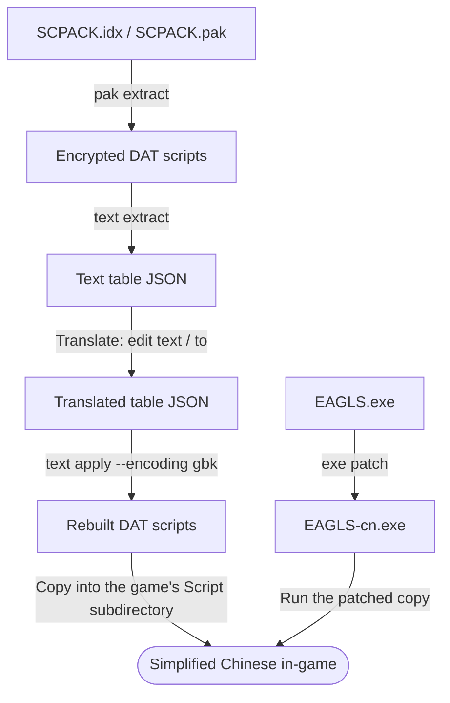

# EAGLS Engine Tool

[中文](README.md) | **English**

**A resource extraction and localization toolkit for games built on the EAGLS engine. Native C++17, command-line first, no third-party dependencies.**


## Overview

EAGLS is a game engine used by a number of Japanese visual novels. Its assets are packed into proprietary formats: IDX/PAK archives, encrypted DAT scripts and GR images. **EAGLS Engine Tool** targets resource extractors and localization teams, covering the entire pipeline from archives and scripts to images and an executable display patch.

The project starts from one principle: **every conclusion is validated against real game assets and in-game behavior.** Format details come from analysis of real samples and the engine itself.

- **Covers the main localization steps**: archive extraction and repacking, script decryption and text reinsertion, image conversion, and a Simplified Chinese display patch.
- **Core and front-ends separated**: all format logic lives in the static library `eagls_core`, shared by the CLI and a future GUI.
- **No third-party dependencies**: only a C++17 compiler and CMake, with no Python, imaging libraries or other external components.
- **Conservative write policy**: input files are never modified in place, existing outputs are not overwritten by default, and every write goes to a separate location.

> [!NOTE]
> **Scope**: verified on only a handful of samples so far; other games and versions are untested and not guaranteed to work. Read the [Disclaimer](#disclaimer) before use.

## Features

| Module     | Command                               | Capability                                                               |
| ---------- | ------------------------------------- | ------------------------------------------------------------------------ |
| Archives   | `pak info`, `pak list`, `pak extract` | Inspect IDX/PAK archives (28/40-byte record layouts), list entries, extract by index verbatim |
| Repacking  | `pak repack`                          | Replace entries with files from a directory, rebuild IDX/PAK              |
| Scripts    | `dat decrypt`, `dat text`             | Decrypt DAT; export the text body preserving its original encoding       |
| Images     | `gr decode`, `gr encode`              | Convert between GR and 24/32-bit BMP                                     |
| Text       | `text extract`, `text apply`          | Extract a JSON text table; reinsert translations and rebuild DAT, with GBK support |
| Executable | `exe check`, `exe patch`              | Apply the GBK Simplified Chinese display patch to EAGLS.exe, with optional Chinese typography |
| GUI        | —                                     | Not integrated yet                                                       |

### Verification

All results below come from real samples. "Independent implementation" means a separate checker written without calling any code from this project.

- **Archives**: SCPACK (279), CGPACK (1,181) and WAVEPACK (3,562) were fully extracted — 5,022 entries in total — and every entry matched an independent implementation by SHA-256; a second sample, SAIMIN (40-byte index record layout), matched the same way — all 140 SCPACK entries compared in full, plus 3 sampled entries each from CGPACK and WAVEPACK (all 10,768 entries of that sample are registered by the independent implementation).
- **Scripts and images**: 279 DAT and 1,181 GR files, 1,739 outputs in total, are byte-identical to the independent implementation; GR encoding was verified by round-trips on real samples and synthetic BMPs (decode → encode → decode, byte-identical).
- **Text**: the full table covers 187 DAT files, 17,414 text entries and 71 speakers; reinserting an unmodified table reproduces the original file byte-for-byte; the 10 GBK translations in `a001.dat` were verified in-game.
- **Repacking**: with no replacement or an identical replacement, the rebuilt idx/pak is byte-identical to the original (regressions cover both the 28- and 40-byte record layouts); after replacing content the archive can be reopened and extracted again. Under the 40-byte record layout, replacing an entry with an empty file is rejected (a zero length would be taken as the engine's scan terminator).
- **Executable**: the 6-byte base GBK patch is verified in-game, and its output is byte-identical to the independent implementation.

### Known limitations

- Only a few games have been verified; other games, versions, and BM8 / palette images are not supported yet. The text table's source encoding currently supports cp932 only.
- GR encoding and PAK repacking outputs have not been load-tested in-game yet. In-game verification so far covers only the chain "patched EAGLS.exe + rebuilt `a001.dat`"; the overall result after a full translation reinsertion has not been verified.
- After patching, the whole game interprets text as GBK, so untranslated Japanese shows up as rare or garbled characters; use it together with a complete translation.
- The font and typography effects of `--typography zh-cn` are still awaiting in-game verification, and it does not handle end-of-line kinsoku or grouping of consecutive punctuation.
- No GUI yet.

## Localization workflow

The diagram below shows the typical flow supported today. The two chains are independent: one handles script text, the other the game's main executable.



The corresponding commands (assuming `eagls.exe` is on your PATH; otherwise use its full path):

```powershell
# 1. Extract the script archive verbatim
eagls pak extract Script\SCPACK.idx Script\SCPACK.pak --out work\script

# 2. Extract the text table and fill in translations
eagls text extract work\script --out work\table.json

# 3. Reinsert the translations as GBK and rebuild the DAT files
eagls text apply work\script --table work\table.json --out work\patched --encoding gbk

# 4. Apply the Simplified Chinese display patch to the game executable
eagls exe patch EAGLS.exe --out EAGLS-cn.exe
```

- The text table is UTF-8 JSON. `original` / `from` are read-only source text captured at extraction; reinsertion only reads `text` (entry translation) and `to` (speaker translation).
- Translations must not contain `"`, `$`, `#`, `&`, carriage return or line feed; each entry is validated during reinsertion.
- After backing up, copy the DAT files from `work\patched` into the game's `Script` subdirectory and launch the game with `EAGLS-cn.exe`. The engine reads loose scripts first, so `SCPACK.pak` needs no changes (verified on a sample).
- You can also write the rebuilt DAT files back into the archive with `pak repack`, but that output has not been load-tested in-game yet.

## Build and test

A **C++17** compiler and **CMake 3.20+** are required. Building and testing are currently done on Windows only (MinGW and Visual Studio 2022). The build downloads no dependencies and does not invoke Git.

An out-of-source build directory is mandatory; in-source builds are not supported. The commands below all run in PowerShell from the project root; each toolchain uses its own build directory and does not share the CMake cache.

### MinGW

First add the directories containing `g++` and `mingw32-make` to the current terminal's PATH:

```powershell
cmake -S . -B build/mingw -G "MinGW Makefiles" -DCMAKE_BUILD_TYPE=Release
cmake --build build/mingw --parallel
ctest --test-dir build/mingw --output-on-failure

.\build\mingw\bin\eagls.exe --help
.\build\mingw\bin\eagls.exe --version
```

When running a program built with MinGW, the system must also find that toolchain's runtime DLLs, which PATH usually provides on a development machine.

### Visual Studio 2022

Install the Desktop development with C++ workload and the Windows SDK; this generator requires CMake 3.21+:

```powershell
cmake -S . -B build/msvc -G "Visual Studio 17 2022" -A x64
cmake --build build/msvc --config Release --parallel
ctest --test-dir build/msvc -C Release --output-on-failure

.\build\msvc\bin\Release\eagls.exe --help
```

### Core library only

```powershell
cmake -S . -B build/core-only -DEAGLS_BUILD_CLI=OFF -DBUILD_TESTING=OFF
cmake --build build/core-only --config Release --parallel
```

The core library target is `eagls_core`, linkable as `eagls::core`. There is currently no GUI build switch.

| CMake option              | Default | Purpose                                                          |
| ------------------------- | ------- | ---------------------------------------------------------------- |
| `EAGLS_BUILD_CLI`         | `ON`    | Build the command-line program `eagls` (target `eagls_cli`)      |
| `BUILD_TESTING`           | `ON`    | Build and register tests; the core can still be tested with the CLI disabled |
| `EAGLS_LOCAL_CONTENT_DIR` | empty   | Points to a directory of extracted samples, enabling the real-sample regression (see below) |


## Command reference

```text
eagls                        Show help (same as --help, -h)
eagls --version              Show the versions of eagls and the core library
eagls <command-group> --help Show help for the pak, dat, gr, text and exe groups
```

General conventions:

- `<file-or-directory>`: a directory input only processes files with the matching extension in its top level; it is not recursive.
- For `dat`, `gr` and `text apply`, `--out` is an output directory; for `text extract`, `--out` is the table file.
- Existing outputs are not overwritten by default; pass `--overwrite` explicitly when needed; no command ever overwrites an input in place.
- Exit codes: `0` success; `1` archive, decode or write failure; `2` argument error (unknown or extra arguments, not-yet-implemented commands, usage errors). Error messages go to standard error.

### Archives (pak)

```text
eagls pak info    <idx> <pak>
eagls pak list    <idx> <pak>
eagls pak extract <idx> <pak> [--out DIR] [--entry NAME]... [--overwrite]
eagls pak repack  <idx> <pak> --from DIR [--out DIR] [--overwrite]
```

- `info`: show archive information (index record layout, seed, entry count, data size, entry coverage).
- `list`: list every entry (slot, name, physical offset, size).
- `extract`: extract by index verbatim, without any decryption or conversion. Outputs to `<pak directory>/<pak stem>_out` by default; `--entry` may be repeated, a name may carry a directory prefix, and only the part after the last separator is compared.
- `repack`: replace same-named entries with the files in the `--from` directory and rebuild the archive. Every regular file in the directory must match exactly one entry (ASCII case-insensitive), otherwise it fails. Outputs to `<pak directory>/<pak stem>_repack` by default. If the archive's layout treats a zero length as the engine's scan terminator (the 40-byte record layout), replacing an entry with an empty file is explicitly rejected.

### Scripts and images (dat, gr)

```text
eagls dat decrypt <file-or-directory> --out DIR [--overwrite]
eagls dat text    <file-or-directory> --out DIR [--overwrite]
eagls gr  decode  <file-or-directory> --out DIR [--overwrite]
eagls gr  encode  <file-or-directory> --out DIR [--store] [--overwrite]
```

- `dat decrypt`: export the decrypted DAT, preserving the label table, terminator and seed. For inspection only; the result cannot be put back into the game directly.
- `dat text`: export the `.txt` text body, preserving the original encoding and line breaks, without transcoding.
- `gr decode`: export a 24/32-bit BMP, fixing the size fields in the file header and dropping padding after the pixel data. For 32-bit images the 4th byte is preserved as-is; its in-game blending semantics are not verified yet.
- `gr encode`: encode a 24/32-bit BMP into `.gr`; `--store` disables compression and writes a fully literal stream.

### Text (text)

```text
eagls text extract <file-or-directory> --out FILE.json [--overwrite]
eagls text apply   <file-or-directory> --table FILE.json --out DIR [--overwrite] [--encoding cp932|gbk]
```

- `extract`: extract a JSON table containing Japanese text and speakers from raw DAT files (or `.dat` files in a directory).
- `apply`: rebuild encrypted DAT files from the table, writing only the files listed in it. `--encoding` selects the translation encoding, `cp932` by default; use `gbk` together with the Simplified Chinese patch. When the table is unmodified, the reinserted output is byte-identical to the original file.

### Executable (exe)

```text
eagls exe check <EAGLS.exe> [--typography zh-cn]
eagls exe patch <EAGLS.exe> [--out FILE] [--overwrite] [--typography zh-cn]
```

- `check`: locate the selected patch by signature and report its current state without writing files. Only the base GBK patch is checked by default.
- `patch`: write a patched copy, named `<stem>-cn.exe` by default, and refuse to overwrite the input file itself. The patch relies on signature matching; an unrecognized executable produces a clear error and no bytes are written.
- By default only the in-game-verified 6-byte GBK patch is applied, to be used with `text apply --encoding gbk`.
- `--typography zh-cn` (optional): additionally switches the font names to `SimHei` / `SimSun` and ports Chinese line-start kinsoku and punctuation letter-spacing classes, supporting upgrades from a recognized older GBK patch. This mode keeps the original letter-spacing coefficients and single hanging punctuation, **does not handle full consecutive-punctuation or end-of-line kinsoku processing, and its in-game visual result is still to be verified**.

## Project structure

```text
eagls_packer/
├── CMakeLists.txt     # The single build entry point
├── cmake/             # Compile options and version header template
├── include/eagls/     # Public headers of the core library
├── src/               # Core library implementation: archive, codec, operations, support
├── apps/
│   ├── cli/           # Command-line program eagls
│   └── gui/           # GUI integration boundary notes, no code yet
├── tests/             # Core and CLI tests
│   └── fixtures/      # Sample conventions; real samples stay local and are never committed
└── docs/              # Architecture design documents
```

See [Architecture](docs/architecture.md) for each directory's responsibilities and dependency direction.

## Disclaimer

Read and understand the following before using this project.

1. **Intended use**: This project is for learning, research and technical exchange only, and aims to help users extract and localize (translate) games they legally own. Do not use it commercially or for any activity that infringes on the lawful rights of others.
2. **No game content**: This repository contains and distributes no game programs, game assets or modified game files. Real samples used for testing are kept only locally by the user and are never committed to the repository.
3. **Rights**: The EAGLS engine, along with each game's program, images, audio and text, together with the vendors, game names and trademarks mentioned here, remain the property of their respective rights holders. This project is an independent third-party tool with no affiliation, authorization or partnership with the engine developer or the related game vendors; those names are mentioned only to describe the compatibility scope.
4. **Legal compliance**: Before extracting, modifying or distributing game content, make sure you comply with the laws of your jurisdiction and the game's end-user license agreement. If you share localization results, publish only patches that contain no original game assets and respect the rights holders' wishes. Any legal liability arising from use is borne by the user.
5. **Compatibility and data safety**: This tool has been verified on only a few samples; other games or versions may fail or even produce incorrect output. Back up your original game files and saves before use; `--overwrite` replaces existing output files.
6. **No warranty**: This project is provided "AS IS", without warranty of any kind, express or implied. The authors are not liable for any direct or indirect loss caused by using or being unable to use this tool (including but not limited to game corruption, data loss and legal disputes). See [LICENSE](LICENSE) for the exact terms.

## License

This project is released under the [MIT License](LICENSE). Rights to the games and their assets belong to their respective owners and are not covered by this license.