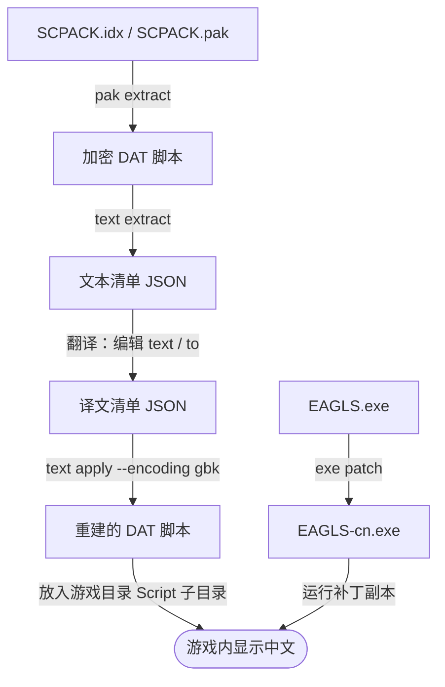

# EAGLS Engine Tool

**中文** | [English](README.en.md)

**面向 EAGLS 引擎游戏的资源提取与翻译工具集。C++17 实现，命令行优先。**


## 项目简介

EAGLS 是部分日文视觉小说所使用的游戏引擎，游戏资源封装在 IDX/PAK 归档、加密的 DAT 脚本与 GR 图像等私有格式中。**EAGLS Engine Tool** 面向资源提取者与汉化人员，提供从归档、脚本、图像到可执行文件显示补丁的完整处理链路。

项目的出发点是：**一切结论以真实游戏资源与游戏内行为为准**。格式细节来自对真实样本与引擎本体的分析

- **覆盖汉化的主要环节**：归档提取与回包、脚本解密与文本回填、图像互转、中文显示补丁。
- **核心与前端分离**：全部格式逻辑集中在静态库 `eagls_core`，CLI 与未来的 GUI 共用同一套核心。
- **无第三方依赖**：只需 C++17 编译器与 CMake，不依赖 Python、图像库或其他外部组件。
- **保守的写入策略**：不就地修改输入文件，默认不覆盖已有输出，所有写操作都落到独立位置。

> [!NOTE]
> **兼容范围**：目前仅在极少数样本上完成验证，其他游戏及版本尚未验证，不保证可用。使用前请阅读[免责声明](#免责声明)。

## 功能一览

| 模块       | 命令                                  | 能力                                                        |
| ---------- | ------------------------------------- | ----------------------------------------------------------- |
| 归档       | `pak info`、`pak list`、`pak extract` | 检查 IDX/PAK 归档（28/40 字节记录两种布局）、列出条目、按索引原样提取 |
| 回包       | `pak repack`                          | 用目录中的文件替换条目，重建 IDX/PAK                        |
| 脚本       | `dat decrypt`、`dat text`             | 解密 DAT；导出保留原编码的正文                              |
| 图像       | `gr decode`、`gr encode`              | GR 与 24/32 位 BMP 互相转换                                 |
| 文本       | `text extract`、`text apply`          | 提取 JSON 文本清单；按清单回填译文并重建 DAT，支持 GBK 译文 |
| 可执行文件 | `exe check`、`exe patch`              | 为 EAGLS.exe / SAIMIN.exe 打 GBK 中文显示补丁，可选中文排版（仅 EAGLS） |
| 存档 | `save info`、`save state`、`save decrypt`、`save encrypt` | EAGLS v2.0 存档读取、部分状态报告、解密解压和无损重建 |
| 图形界面   | —                                     | 尚未接入                                         |

### 验证情况

以下结果均来自真实样本。「独立实现」指不调用本项目任何代码、单独编写的校验程序。

- **归档**：SCPACK 279、CGPACK 1,181、WAVEPACK 3,562，共 5,022 个条目全量提取，与独立实现逐一比对 SHA-256，全部一致；第二个样本 SAIMIN（40 字节索引记录布局）SCPACK 140 条全量比对、CGPACK/WAVEPACK 各抽检 3 条，同样一致（该样本共 10,768 个条目已由独立实现登记）。
- **脚本与图像**：279 个 DAT 与 1,181 张 GR，共 1,739 个输出与独立实现逐字节一致；GR 编码经真实样本与合成 BMP 往返验证（解码、编码、再解码逐字节一致）。
- **文本**：全量清单覆盖 187 个 DAT、17,414 条文本、71 位说话者；未改动的清单回填后与原文件逐字节一致；`a001.dat` 中的 10 条 GBK 译文已通过游戏内显示验证。
- **回包**：无替换与原样替换时，重建的 idx/pak 与原文件逐字节一致（28 与 40 字节记录布局各有回归）；替换内容后可重新打开并提取。40 字节记录布局下拒绝把条目替换成空文件（长度 0 是引擎的扫描终止标记）。
- **可执行文件**：EAGLS 的 6 字节基础 GBK 补丁已通过游戏内验证，产物与独立实现逐字节一致；SAIMIN 的 5 字节补丁已完成字节级定位（真实样本 + 合成回归）与双编译器产物一致性验证，**游戏内待验收**。
- **存档**：EAGLS v2.0的22个真实存档通过独立实现比对与逐字节重建；重编码及部分字段修改通过游戏内保存重读验证。真实样本仅用于本地验证，不提交。

### 已知限制

- 仅验证过少数游戏；其他游戏、版本，以及 BM8 / 调色板图像尚未适配。文本清单的原文编码目前仅支持 cp932。
- GR 编码与 PAK 回包的产物尚未做游戏内加载验收。脚本汉化链路目前只验证了「已打补丁的 EAGLS.exe + 重建的 `a001.dat`」，全量翻译回填后的整体表现尚未验收。
- 打补丁后整个游戏按 GBK 解释文本，未翻译的日文会显示为生僻字，建议配合完整翻译使用。
- `--typography zh-cn` 的字体与排版效果尚待游戏内验收，且不含行尾禁则与连续标点成组处理。
- 存档仅验证EAGLS v2.0；内部状态语义仍是部分解析（`partial_schema: true`），具体兼容范围见存档指南。
- 暂无图形界面。

存档命令、格式说明与验证范围见 [EAGLS v2.0存档指南](docs/eagls-save-v2.md)。

## 汉化工作流

下图是目前支持的典型流程。两条链路相互独立：一条处理脚本文本，一条处理游戏主程序。



对应的命令如下（假设 `eagls.exe` 已在 PATH 中，否则请改用其完整路径）：

```powershell
# 1. 原样提取脚本归档
eagls pak extract Script\SCPACK.idx Script\SCPACK.pak --out work\script

# 2. 提取文本清单，并在清单中填写译文
eagls text extract work\script --out work\table.json

# 3. 以 GBK 编码回填译文，重建 DAT
eagls text apply work\script --table work\table.json --out work\patched --encoding gbk

# 4. 为游戏主程序打中文显示补丁
eagls exe patch EAGLS.exe --out EAGLS-cn.exe
```

- 文本清单是 UTF-8 JSON。`original` / `from` 是提取时的只读原文，回填只读取 `text`（条目译文）与 `to`（说话者译名）。
- 译文不得包含 `"`、`$`、`#`、`&`、回车或换行，回填时会逐条校验。
- 备份后，把 `work\patched` 中的 DAT 复制到游戏目录的 `Script` 子目录，再用 `EAGLS-cn.exe` 启动游戏。引擎会优先读取松散脚本，因此无需改动 `SCPACK.pak`（已在样本上实测）。
- 也可以用 `pak repack` 把重建的 DAT 写回归档，但该产物尚未做游戏内加载验收。

## 构建与测试

需要支持 **C++17** 的编译器与 **CMake 3.20+**。目前仅在 Windows（MinGW 与 Visual Studio 2022）上构建和测试。构建过程不会下载依赖，也不会调用 Git。

必须使用独立的构建目录，不支持源码内构建。以下命令均在项目根目录的 PowerShell 中运行；不同工具链使用各自的构建目录，互不共享 CMake 缓存。

### MinGW

先把 `g++` 与 `mingw32-make` 所在目录加入当前终端的 PATH：

```powershell
cmake -S . -B build/mingw -G "MinGW Makefiles" -DCMAKE_BUILD_TYPE=Release
cmake --build build/mingw --parallel
ctest --test-dir build/mingw --output-on-failure

.\build\mingw\bin\eagls.exe --help
.\build\mingw\bin\eagls.exe --version
```

运行 MinGW 编译的程序时，系统也需要能找到同一工具链的运行库 DLL，开发机上通常由 PATH 提供。

### Visual Studio 2022

需要安装 C++ 桌面开发工具与 Windows SDK；该生成器要求 CMake 3.21+：

```powershell
cmake -S . -B build/msvc -G "Visual Studio 17 2022" -A x64
cmake --build build/msvc --config Release --parallel
ctest --test-dir build/msvc -C Release --output-on-failure

.\build\msvc\bin\Release\eagls.exe --help
```

### 仅构建核心库

```powershell
cmake -S . -B build/core-only -DEAGLS_BUILD_CLI=OFF -DBUILD_TESTING=OFF
cmake --build build/core-only --config Release --parallel
```

核心库目标为 `eagls_core`，可通过 `eagls::core` 链接。目前没有 GUI 构建开关。

| CMake 选项                | 默认值 | 作用                                           |
| ------------------------- | ------ | ---------------------------------------------- |
| `EAGLS_BUILD_CLI`         | `ON`   | 构建命令行程序 `eagls`（目标名 `eagls_cli`）   |
| `BUILD_TESTING`           | `ON`   | 构建并注册测试；关闭 CLI 时仍可测试核心        |
| `EAGLS_LOCAL_CONTENT_DIR` | 空     | 指向已提取的样本目录，启用真实样本回归（见下） |


## 命令参考

```text
eagls                        显示帮助（同 --help、-h）
eagls --version              显示 eagls 与核心库的版本
eagls <命令组> --help        显示 pak、dat、gr、text、exe、save 各命令组的帮助
```

通用约定：

- `<文件或目录>`：目录输入只处理当前层中对应扩展名的文件，不递归。
- `dat`、`gr` 与 `text apply` 的 `--out` 是输出目录；`text extract` 的 `--out` 是清单文件。
- 已存在的输出默认不覆盖，需要时显式加 `--overwrite`；任何命令都不允许就地覆盖输入。
- 退出码：`0` 成功；`1` 归档、解码或写入失败；`2` 参数错误（未知或多余的参数、尚未实现的命令、用法错误），错误信息写入标准错误。

### 归档（pak）

```text
eagls pak info    <idx> <pak>
eagls pak list    <idx> <pak>
eagls pak extract <idx> <pak> [--out DIR] [--entry NAME]... [--overwrite]
eagls pak repack  <idx> <pak> --from DIR [--out DIR] [--overwrite]
```

- `info`：显示归档信息（索引记录布局、种子、条目数、数据大小、条目覆盖情况）。
- `list`：列出全部条目（槽位、名称、物理偏移、大小）。
- `extract`：按索引原样提取，不做任何解密或转换。默认输出到 `<pak 所在目录>/<pak 主文件名>_out`；`--entry` 可重复，名称可带目录前缀，比较时只取最后一个分隔符之后的部分。
- `repack`：用 `--from` 目录中的文件替换同名条目并重建归档。目录中的每个普通文件都必须唯一匹配一个条目（忽略 ASCII 大小写），否则报错。默认输出到 `<pak 所在目录>/<pak 主文件名>_repack`。若归档的布局把长度 0 当作引擎扫描的终止标记（40 字节记录布局），把条目替换成空文件会被明确拒绝。

### 脚本与图像（dat、gr）

```text
eagls dat decrypt <文件或目录> --out DIR [--overwrite]
eagls dat text    <文件或目录> --out DIR [--overwrite]
eagls gr  decode  <文件或目录> --out DIR [--overwrite]
eagls gr  encode  <文件或目录> --out DIR [--store] [--overwrite]
```

- `dat decrypt`：导出解密后的 DAT，保留标签表、终止符与种子。仅用于检查，不能直接放回游戏。
- `dat text`：导出 `.txt` 正文，保留原编码与换行，不自动转码。
- `gr decode`：导出 24/32 位 BMP，修正文件头中的大小字段，丢弃像素数据之后的填充。32 位图像的第 4 字节原样保留，其在游戏内的混合语义尚未验证。
- `gr encode`：把 24/32 位 BMP 编码为 `.gr`；`--store` 不压缩，以全字面量写出。

### 文本（text）

```text
eagls text extract <文件或目录> --out FILE.json [--overwrite]
eagls text apply   <文件或目录> --table FILE.json --out DIR [--overwrite] [--encoding cp932|gbk]
```

- `extract`：从原始 DAT（或目录中的 `.dat`）提取含日文文本与说话者的 JSON 清单。
- `apply`：按清单重建加密 DAT，只写清单内的文件。`--encoding` 选择译文编码，默认 `cp932`；配合中文补丁时使用 `gbk`。清单未改动时，回填产物与原文件逐字节一致。

### 可执行文件（exe）

```text
eagls exe check <EAGLS.exe|SAIMIN.exe> [--typography zh-cn]
eagls exe patch <EAGLS.exe|SAIMIN.exe> [--out FILE] [--overwrite] [--typography zh-cn]
```

- `check`：按特征码**自动识别 EAGLS / SAIMIN 版本**并报告所选补丁的当前状态，不写文件。默认只检查基础 GBK 补丁。
- `patch`：写出补丁副本，默认文件名为 `<主文件名>-cn.exe`，拒绝覆盖输入文件本身。补丁依赖特征码定位，遇到未识别的可执行文件会明确报错，不会写入任何字节。
- 默认是已游戏内验证的 GBK 补丁（EAGLS 6 处 / SAIMIN 5 处），需配合 `text apply --encoding gbk`；SAIMIN 的补丁**游戏内待验收**。
- `--typography zh-cn`（可选，仅 EAGLS 版）：另把字体名换为 `SimHei` / `SimSun`，并迁移中文行首禁则与标点字距分类，支持从已识别的旧 GBK 补丁升级。该模式沿用原字距系数与单次悬挂，**不含完整的连续标点与行尾禁则处理，游戏内视觉效果待验收**。

## 项目结构

```text
eagls_packer/
├── CMakeLists.txt     # 唯一的构建入口
├── cmake/             # 编译选项与版本头模板
├── include/eagls/     # 核心库公开头文件
├── src/               # 核心库实现：archive、codec、operations、support
├── apps/
│   ├── cli/           # 命令行程序 eagls
│   └── gui/           # GUI 接入边界说明，暂无代码
├── tests/             # 核心与 CLI 测试
│   └── fixtures/      # 样本约定；仅合成样例；真实样本仅本地
└── docs/              # 架构设计文档
```

各目录的职责与依赖方向详见 [架构设计](docs/architecture.md)。

## 免责声明

使用本项目前，请先阅读并理解以下声明。

1. **用途限制**：本项目仅供学习、研究与技术交流，旨在协助用户对自己合法持有的游戏进行资源提取与汉化（本地化）研究。请勿用于商业用途，或任何侵害他人合法权益的行为。
2. **不含游戏内容**：本仓库不包含、也不分发任何游戏程序、游戏资源或经修改的游戏文件。测试所用的真实样本只保存在使用者本地，不会提交到仓库。
3. **权利归属**：EAGLS 引擎，以及各游戏的程序、图像、音频与文本等内容，连同文中提及的厂商、游戏名称与商标，其权利均归各自的原权利人所有。本项目是独立的第三方工具，与引擎开发者及相关游戏厂商没有任何隶属、授权或合作关系；文中提及这些名称仅用于说明兼容范围。
4. **合法合规**：提取、修改或分发游戏内容之前，请确认已遵守所在地区的法律法规及游戏的最终用户许可协议。如需分享汉化成果，建议仅发布不含原始游戏资源的补丁，并尊重权利人的意愿。由此产生的法律责任由使用者自行承担。
5. **兼容性与数据安全**：本工具仅在少数样本上验证过，其他游戏或版本可能无法使用，甚至产生错误的输出。使用前请备份原始游戏文件与存档；`--overwrite` 会覆盖已存在的输出文件。
6. **无担保**：本项目按「现状」（AS IS）提供，不附带任何明示或默示的担保。作者不对因使用或无法使用本工具而造成的任何直接或间接损失（包括但不限于游戏损坏、数据丢失与法律纠纷）承担责任。具体条款以 [LICENSE](LICENSE) 为准。

## 许可证

本项目以 [MIT 许可证](LICENSE) 发布。游戏及其资源的权利归原权利人所有，不适用该许可证。
