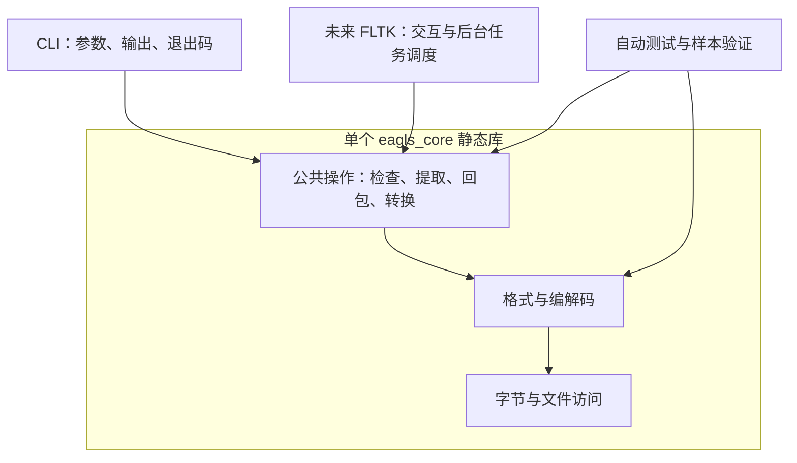

# 架构设计与重启边界

## 1. 已确定的原则

- 使用 C++17，优先支持现有 Windows 开发环境；不因界面选型阻塞核心功能。
- 单一根 CMake 入口。初期只有一个 `eagls_core` 静态库，不按文件类型拆成多个 DLL。
- CLI 与未来 GUI 直接调用相同的 C++ 公共操作，不让 GUI 启动 CLI 后解析终端文字。
- GUI 暂定 FLTK；本阶段不下载、不链接、不实现 GUI。
- 真实资源、独立证据与游戏行为决定兼容性。历史代码仅能提供待验证线索。
- 当前代码只有版本接口和 CLI 骨架。下图中的公共操作与格式模块是后续实现方向，不是已经存在的能力。

## 2. 依赖方向

箭头表示调用与依赖，不表示每个方框都应建立一个库或抽象基类。

## 3. 文件职责与扩展方式

| 路径 | 职责与限制 |
| --- | --- |
| `include/eagls/` | 对外可用的核心头文件；不含 GUI 类型、终端输出或框架事件循环 |
| `src/` | 核心实现及私有头文件；目前仅 `version.cpp` |
| `apps/cli/` | 命令解析、参数校验、终端呈现和退出码；不实现格式算法 |
| `apps/gui/` | 未来 FLTK 控件、模型适配和任务调度；目前只保留说明 |
| `tests/` | 直接链接核心的测试，以及真实进程级 CLI 测试 |
| `tests/fixtures/` | 合成样本约定与本地真实样本位置 |
| `cmake/` | 项目自身的编译选项和版本生成模板 |
| `reference/python/` | 未验证的历史参考；不参与生产构建、测试自动发现或安装 |

实现首个功能时再按需要添加这些库内目录：

- `src/archive/`：IDX/PAK 解析与容器模型。
- `src/codec/`：经过验证的解密与压缩算法。
- `src/operations/`：面向前端的完整操作，组合格式、编解码与文件访问。
- 图像、文本职责到对应功能开始时再细分，不先创建空目录和空类。

公开头文件只暴露确实需要被 CLI、GUI 或外部调用者使用的接口；不机械复制所有内部文件到 `include/`。

## 4. 核心边界约定

以下约定指导后续功能实现，本次不预造接口：

1. 容器解析、内容解密、解压和图像/文本转换分开，原样提取不得隐式转换文件内容。
2. 使用明确宽度的整数读取磁盘字段，显式处理字节序；不把文件字节直接强转成依赖布局的 C++ 结构体。
3. 将文件名原始字节与展示用文本区分开，不把 UTF-8、Shift-JIS 或本机编码当作未经验证的格式事实。
4. 文件路径使用 `std::filesystem::path`；Windows 命令行路径转换属于入口适配，不让核心依赖终端代码页。
5. 核心不打印日志、不弹窗、不主动结束进程；错误交给调用方呈现。具体错误接口在第一个资源操作中确定。
6. 操作可同步执行，后台线程由前端安排。需要进度和取消时使用普通 C++ 接口，并记录回调发生的线程；不在核心中直接更新控件或另造通用任务框架。
7. 对空/短文件、越界偏移、非法长度和覆盖已有输出作必要检查，不为纯本地工具添加无关的服务端架构。
8. 不自动覆盖游戏原件；回包等写操作使用独立输出位置，并通过游戏行为验证结果。

## 5. 构建与依赖

- `eagls_core`：静态核心库，别名 `eagls::core`，公开 C++17 要求。
- `eagls_cli`：可选 CLI 目标，输出程序名 `eagls`，只链接核心。
- `eagls_core_tests`：启用 `BUILD_TESTING` 时构建；不依赖 CLI 或 GUI。
- CLI 测试仅在 CLI 开启时注册。测试使用 CTest 和小型测试程序，无需下载测试框架。
- `/W4 /permissive- /utf-8` 或 `-Wall -Wextra -Wpedantic` 仅应用于自有目标。
- 根 `project(... VERSION ...)` 是版本号的唯一维护位置；生成配置只在构建目录内。
- 不提交手工维护的 `.sln`、`.vcxproj` 或二进制依赖；使用 CMake 生成工具链对应的工程。
- 新增第三方依赖时明确版本、许可、构建与发布代价，不自动沿用旧 ImGui/libpng 二进制。

## 6. 实现顺序与验收

| 阶段 | 工作 | 完成证据 |
| --- | --- | --- |
| 工程重启 | 目录、核心链接、CLI 骨架、测试入口 | 干净构建与骨架测试通过；不宣称已支持游戏 |
| 首个资源闭环 | 取得真实 IDX/PAK、核实索引、列目录、原样提取 | 偏移与长度有独立依据，提取内容与 PAK 对应字节区间一致 |
| 内容解码 | 分开验证解密、解压和 GR 图像解析 | 已知样本、独立实现或游戏加载结果交叉验证 |
| 写回能力 | 回包与必要的文本回填 | 写入新文件后游戏能够识别，相关行为正常 |
| GUI 接入 | FLTK 调用已验证公共操作 | 交互不阻塞，复用 CLI 已验证的核心行为 |

首个真实游戏与样本尚未选定；不能先把旧实现中的常量写成新规范。

测试逐步覆盖：空/短输入、索引范围、文件名边界、算法种子边界、已知字节序列，以及真实样本的交叉验证。仅用同一套代码做解包再回包不能证明兼容。

## 7. 本次清理记录

经确认移除了旧 `bmp2gr/`、`pak_packer/`、`pak_unpacker/`、`eagls_engine_tool/`（包含 ImGui/libpng）、旧根 `build/`、`x64/` 和 `Eagls_engine_tool.sln`；重建了根 CMake 与 README。

15 个 Python 脚本由 `python_script/` 原样迁移至 `reference/python/`，不修复、不执行。Git 目录、许可证、协作文件和用户编辑器配置保持原位。本次没有调用 Git、创建 Git 备份或安装依赖。
